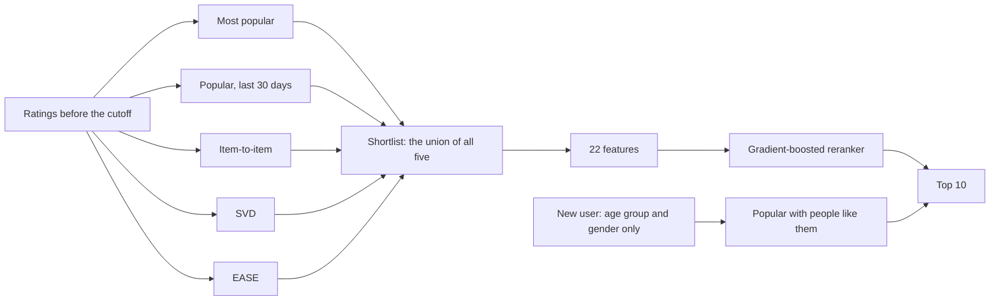

# Two-stage movie recommender

Five fast models each shortlist movies for a person, then a gradient-boosted reranker orders the shortlist. Trained and tested on [MovieLens 1M](https://grouplens.org/datasets/movielens/1m/) (1,000,209 ratings) with a time-based split. It's scored with Recall@10 and NDCG@10 against a most-popular baseline, and new users with no history get a fallback.

**Live demo and results: https://yashvardhan0505.github.io/movie-recommender/**

## Results

<!-- results:start -->
| Method | Recall@10 | NDCG@10 |
|---|---:|---:|
| **Two-stage: retrieve + rerank** | 0.0657 | 0.2917 |
| Most popular, last 30 days | 0.0500 | 0.2736 |
| EASE | 0.0494 | 0.2559 |
| Matrix factorisation (SVD) | 0.0443 | 0.2425 |
| Item-to-item | 0.0402 | 0.2564 |
| Most popular (baseline) | 0.0394 | 0.2539 |

Returning users: 1,180, scored on everything they rated after 2000-12-29.
New users (29, no history): popular with their age group and gender Recall@10 0.0635, against 0.0577 for most popular overall.

Resume line, with these numbers:

> Built a two-stage movie recommender on MovieLens 1M (1,000,209 ratings): five retrieval models (two popularity lists, item-to-item, SVD and EASE) shortlist candidates and a gradient-boosted reranker orders them. On a time-based split it reaches Recall@10 0.066 and NDCG@10 0.292, 1.7× a most-popular baseline, and serves new users from age and gender segments (1.1× the baseline's recall for them).

_Updated 2026-11-25. Full tables: [results/metrics.md](results/metrics.md)._
<!-- results:end -->

## How it works



1. **Split by time.** Ratings are cut at the 80th and 90th percentiles of their timestamps. Before the first cut is history. The reranker learns from what people rated between the two cuts. Everything after the second cut is the test. A random split would let models learn from other people's future ratings, which inflates offline scores.
2. **Retrieve.** Five models each propose their top 50 to 100 unseen movies per person:
   - most popular, the baseline
   - most popular in the last 30 days
   - item-to-item cosine similarity
   - PureSVD with 64 factors
   - [EASE](https://arxiv.org/abs/1905.03375), a closed-form linear model that's strong on MovieLens

   Their union is the shortlist. "Shortlist recall" is the share of each person's next movies that made it in, and it caps what the reranker can achieve.
3. **Rerank.** A `HistGradientBoostingClassifier` predicts, for every (person, candidate) pair, whether the person goes on to rate that movie. The labels come from the validation period, with retrieval fitted only on what came before it. The features:
   - every model's score and exact rank for the candidate
   - the movie's popularity, 30-day trend, age and average rating (shrunk towards the mean)
   - the person's history length, average rating and how mainstream their taste is
   - genre match with their history
   - popularity among people of the same age group and gender

   For the test, retrieval is refitted on everything before the test cutoff, and the top 10 by predicted probability are the recommendations.
4. **New users.** People whose first rating comes after the cutoff have no history. They get what's been popular lately with their age group and gender (MovieLens 1M records both), blended with overall popularity.

### Design notes

- **Fair comparison.** Every method is scored on the same users with the same metric code (`recsys/metrics.py`).
- **No leakage.** All features are computed from history before the cutoff. A test scrambles every rating after the cutoff and checks that no feature changes.
- **Pointwise reranking.** The reranker is a classifier, a simpler stand-in for a learning-to-rank objective such as LambdaMART. Users none of whose candidates were watched are left out of training, because they say nothing about ordering.
- **Feature importance.** It's measured as the drop in each user's NDCG@10 when a feature is shuffled. User features are shuffled between users and movie features between movies, so the measure reflects ordering within a person's list.
- **The demo.** The page runs the item-to-item model in the browser over the 1,500 most-rated movies, so it needs no server. The published numbers are from the full two-stage system.

## Run it

### On GitHub (no setup)

1. Create a public repository named `movie-recommender` and upload this folder's contents, including the `.github` folder.
2. In **Settings → Pages**, set **Source** to **GitHub Actions**.
3. In **Actions → Build results and site**, click **Run workflow**. It takes about 3 minutes. It downloads MovieLens 1M, trains and evaluates, commits `results/`, `docs/` and the numbers in this README, and publishes the page.

No API keys or secrets are needed.

### On your computer

```bash
pip install -r requirements.txt
python -m recsys run       # downloads MovieLens 1M (6 MB), takes 1 to 2 minutes
```

Then open `docs/index.html`. The full tables are in `results/metrics.md`.

`python -m recsys demo` runs the whole pipeline offline on synthetic data in the same format and writes to `preview/`. Run the tests with `pip install pytest`, then `pytest`.

## Layout

| Path | What it does |
|---|---|
| `recsys/data.py` | Downloads and parses MovieLens 1M, and cleans titles ("Matrix, The" becomes "The Matrix") |
| `recsys/split.py` | Time-based validation and test periods; returning and new users |
| `recsys/retrieval.py` | The five retrieval models and the shortlist |
| `recsys/features.py` | Reranker features, from history before the cutoff only |
| `recsys/rerank.py` | The gradient-boosted reranker and permutation importance |
| `recsys/coldstart.py` | Popularity within age group and gender, for new users |
| `recsys/metrics.py` | Recall, NDCG, hit rate, precision and catalog coverage at k |
| `recsys/pipeline.py` | Runs everything and writes `results/` and the README block |
| `recsys/site.py`, `recsys/page.html` | The demo and results page |
| `recsys/synthetic.py` | Synthetic data in MovieLens format, for tests and offline runs |

## Next steps

- A learning-to-rank objective (LambdaMART) instead of pointwise classification.
- Approximate nearest-neighbour retrieval (for example FAISS) for catalogs too large to score in full.
- A two-tower neural retriever as a sixth candidate source.
- Diversity and popularity-bias controls. The results already report how much of the catalog each method recommends.
- An online A/B test, since offline recall isn't the same as what people click.

## Data and licence

MovieLens 1M is from GroupLens Research at the University of Minnesota. Its terms don't allow redistributing the data, so it isn't in this repository: each run downloads it from GroupLens. The page publishes only movie titles and summary statistics. This project isn't endorsed by GroupLens.

> F. Maxwell Harper and Joseph A. Konstan. 2015. The MovieLens Datasets: History and Context. ACM Transactions on Interactive Intelligent Systems (TiiS) 5, 4, Article 19. https://doi.org/10.1145/2827872

The code is under the MIT licence.
